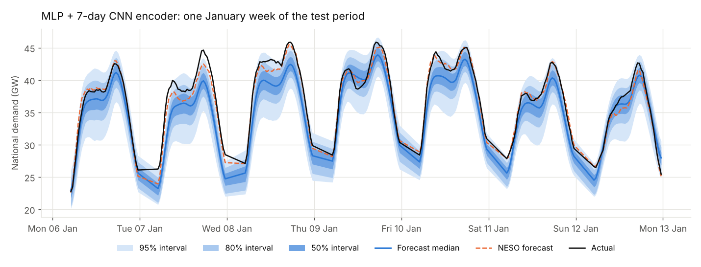
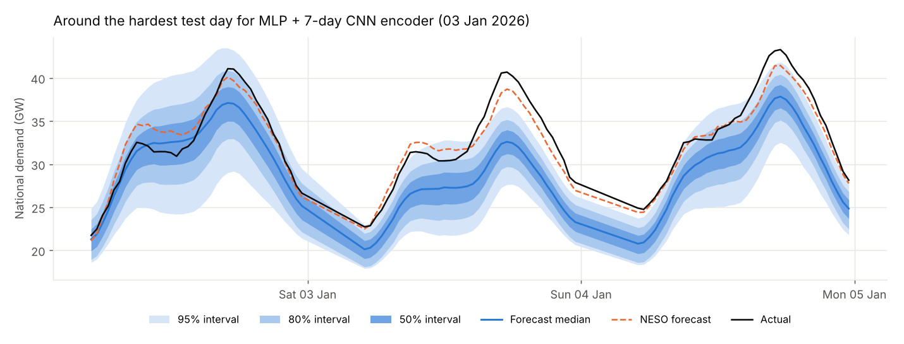
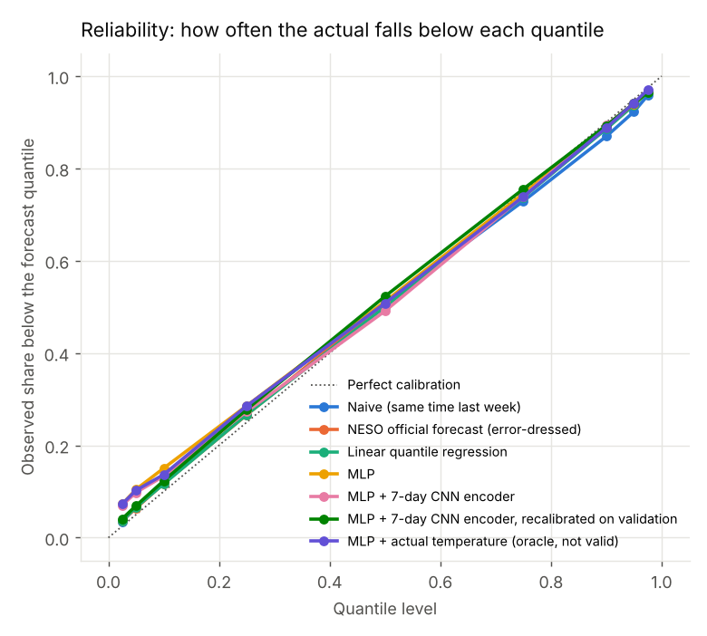
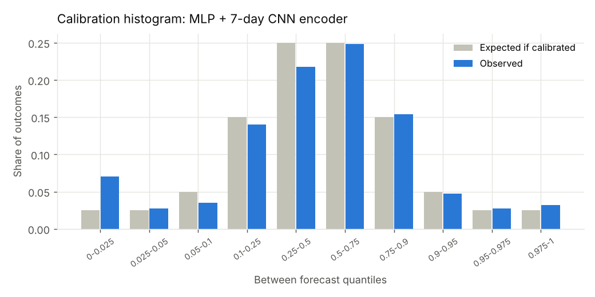
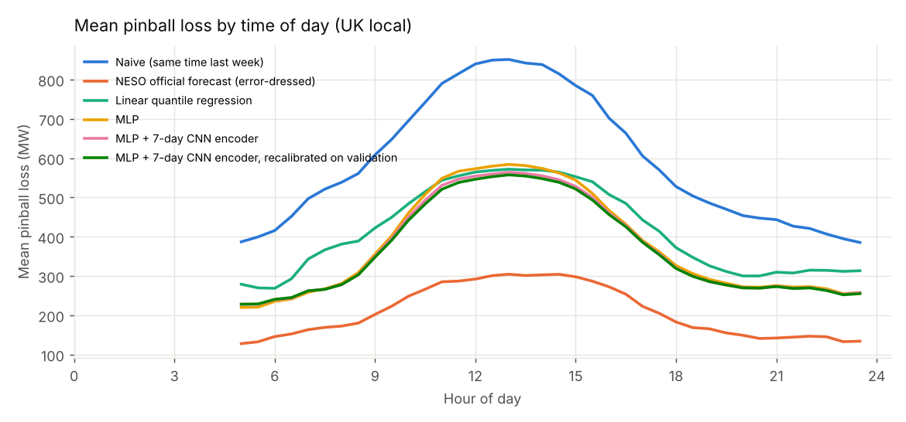
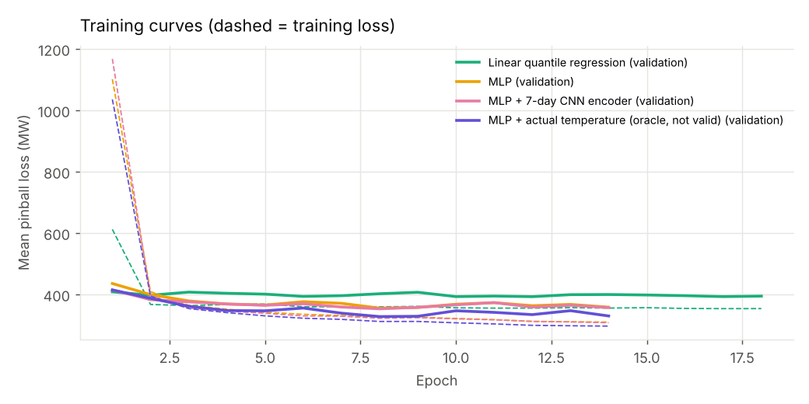

# Results: day-ahead probabilistic forecasts of GB national demand

Generated 2026-10-10 11:48 by `python run.py --offline --rolling`. See [docs/REPORT.md](../docs/REPORT.md) for the full methodology.

## Data

- Demand history: 2018-01-01 to 2026-10-08 (153,742 half-hours). Duplicates removed: 0; implausible values removed: 0; missing half-hours: 654 before gap-filling, 600 after.
- Rows used for modelling: 148,156 (dropped 5,586 without complete inputs).
- Evaluation scheme: quarterly rolling-origin re-training (each quarter forecast by a model trained only on earlier data, with the preceding 12 months used for early stopping).
- Test rows scored: 24,510 half-hours over 645 days (01 Jan 2025 to 08 Oct 2026). Every forecaster is scored on exactly the same rows. 6,496 test half-hours with no NESO forecast published in the six hours before our issue time were excluded for every forecaster.
- Temperature inputs: yes. NESO benchmark: yes (median lead time of the official forecast: 29.2 hours before delivery; ours: 29.0 hours).

## Model selection (validation data only)

The headline model is chosen by validation loss, before looking at the test period.

| Model | Validation mean pinball (MW) |
|---|---|
| Linear quantile regression | 382.2 |
| MLP | 329.3 |
| MLP + 7-day CNN encoder | 327.7 |
| MLP + actual temperature (oracle, not valid) | 298.4 |

Headline model: **MLP + 7-day CNN encoder**.

## Test-period accuracy

| Forecaster | Mean pinball (MW) | Skill vs naive | MAE of median (MW) | MAPE (%) | 50% cov. | 90% cov. | 95% cov. | 90% width (MW) |
|---|---|---|---|---|---|---|---|---|
| Naive (same time last week) | 593.5 | 0.0% | 2305.6 | 8.95 | 44.5% | 85.7% | 92.3% | 8726.7 |
| NESO official forecast (error-dressed) | 207.9 | 65.0% | 814.1 | 3.24 | 47.7% | 87.7% | 92.9% | 3251.0 |
| Linear quantile regression | 414.0 | 30.2% | 1723.5 | 6.87 | 47.1% | 87.2% | 92.8% | 6508.0 |
| MLP | 378.3 | 36.3% | 1528.7 | 6.22 | 46.0% | 83.5% | 89.3% | 5325.0 |
| MLP + 7-day CNN encoder | 371.5 | 37.4% | 1510.3 | 6.10 | 46.6% | 84.3% | 89.8% | 5444.4 |
| MLP + 7-day CNN encoder, recalibrated on validation | 368.5 | 37.9% | 1516.0 | 6.16 | 47.8% | 87.2% | 92.4% | 5838.4 |
| MLP + actual temperature (oracle, not valid) | 346.9 | 41.5% | 1418.4 | 5.83 | 45.3% | 83.9% | 89.7% | 4958.7 |

Pinball loss is averaged over the quantiles 0.025, 0.05, 0.1, 0.25, 0.5, 0.75, 0.9, 0.95, 0.975. Lower is better. Skill = 1 - (loss / naive loss). Coverage should match the nominal level.

## Calibration

### Kupiec tests on the tails

H0: tail exceedances happen at the nominal rate. Half-hourly exceedances are strongly clustered within a day, which breaks the test's independence assumption, so the 17:30-only version (one observation per day) is the more trustworthy of the two.

| model | quantile | sample | n | expected | observed | LR | p_value |
|---|---|---|---|---|---|---|---|
| MLP + 7-day CNN encoder | 0.025 | all half-hours | 24510 | 0.025 | 0.070 | 1392.44 | 0.000 |
| MLP + 7-day CNN encoder | 0.025 | 17:30 only | 645 | 0.025 | 0.053 | 15.49 | 0.000 |
| MLP + 7-day CNN encoder | 0.05 | all half-hours | 24510 | 0.050 | 0.098 | 938.89 | 0.000 |
| MLP + 7-day CNN encoder | 0.05 | 17:30 only | 645 | 0.050 | 0.082 | 11.87 | 0.001 |
| MLP + 7-day CNN encoder | 0.95 | all half-hours | 24510 | 0.050 | 0.059 | 38.89 | 0.000 |
| MLP + 7-day CNN encoder | 0.95 | 17:30 only | 645 | 0.050 | 0.056 | 0.44 | 0.506 |
| MLP + 7-day CNN encoder | 0.975 | all half-hours | 24510 | 0.025 | 0.032 | 43.66 | 0.000 |
| MLP + 7-day CNN encoder | 0.975 | 17:30 only | 645 | 0.025 | 0.023 | 0.08 | 0.774 |
| NESO official forecast (error-dressed) | 0.025 | all half-hours | 24510 | 0.025 | 0.037 | 127.37 | 0.000 |
| NESO official forecast (error-dressed) | 0.025 | 17:30 only | 645 | 0.025 | 0.025 | 0.00 | 0.975 |
| NESO official forecast (error-dressed) | 0.05 | all half-hours | 24510 | 0.050 | 0.064 | 92.94 | 0.000 |
| NESO official forecast (error-dressed) | 0.05 | 17:30 only | 645 | 0.050 | 0.053 | 0.10 | 0.754 |
| NESO official forecast (error-dressed) | 0.95 | all half-hours | 24510 | 0.050 | 0.059 | 38.89 | 0.000 |
| NESO official forecast (error-dressed) | 0.95 | 17:30 only | 645 | 0.050 | 0.070 | 4.75 | 0.029 |
| NESO official forecast (error-dressed) | 0.975 | all half-hours | 24510 | 0.025 | 0.033 | 65.71 | 0.000 |
| NESO official forecast (error-dressed) | 0.975 | 17:30 only | 645 | 0.025 | 0.029 | 0.50 | 0.480 |
| MLP + 7-day CNN encoder, recalibrated on validation | 0.025 | all half-hours | 24510 | 0.025 | 0.041 | 212.42 | 0.000 |
| MLP + 7-day CNN encoder, recalibrated on validation | 0.025 | 17:30 only | 645 | 0.025 | 0.031 | 0.89 | 0.346 |
| MLP + 7-day CNN encoder, recalibrated on validation | 0.05 | all half-hours | 24510 | 0.050 | 0.069 | 172.10 | 0.000 |
| MLP + 7-day CNN encoder, recalibrated on validation | 0.05 | 17:30 only | 645 | 0.050 | 0.062 | 1.83 | 0.176 |
| MLP + 7-day CNN encoder, recalibrated on validation | 0.95 | all half-hours | 24510 | 0.050 | 0.059 | 40.99 | 0.000 |
| MLP + 7-day CNN encoder, recalibrated on validation | 0.95 | 17:30 only | 645 | 0.050 | 0.051 | 0.02 | 0.893 |
| MLP + 7-day CNN encoder, recalibrated on validation | 0.975 | all half-hours | 24510 | 0.025 | 0.035 | 87.64 | 0.000 |
| MLP + 7-day CNN encoder, recalibrated on validation | 0.975 | 17:30 only | 645 | 0.025 | 0.028 | 0.22 | 0.642 |

## Is the difference real? Diebold-Mariano tests

On daily mean pinball loss, with a Newey-West variance (7 lags). A negative statistic means A is better than B.

| A | B | days | mean_diff_mw | DM | p_value |
|---|---|---|---|---|---|
| MLP + 7-day CNN encoder | NESO official forecast (error-dressed) | 645 | 163.6 | 16.29 | 0.0000 |
| MLP + 7-day CNN encoder | Naive (same time last week) | 645 | -222.0 | -8.04 | 0.0000 |
| MLP + 7-day CNN encoder | MLP | 645 | -6.8 | -2.78 | 0.0054 |
| MLP | Linear quantile regression | 645 | -35.7 | -3.91 | 0.0001 |
| MLP + actual temperature (oracle, not valid) | MLP | 645 | -31.4 | -5.45 | 0.0000 |

## Where the forecasts struggle

| regime | model | n | mean_pinball_mw | mae_mw | cov90 | cov50 |
|---|---|---|---|---|---|---|
| weekday (non-holiday) | MLP + 7-day CNN encoder | 16758 | 361.0 | 1466.7 | 85.0% | 47.4% |
| weekday (non-holiday) | Naive (same time last week) | 16758 | 591.4 | 2301.0 | 85.9% | 44.2% |
| weekday (non-holiday) | NESO official forecast (error-dressed) | 16758 | 203.6 | 805.1 | 88.4% | 47.7% |
| weekend (non-holiday) | MLP + 7-day CNN encoder | 6916 | 381.3 | 1556.4 | 83.3% | 45.2% |
| weekend (non-holiday) | Naive (same time last week) | 6916 | 551.8 | 2174.2 | 87.6% | 46.5% |
| weekend (non-holiday) | NESO official forecast (error-dressed) | 6916 | 213.9 | 821.6 | 86.8% | 48.1% |
| bank holiday or Christmas | MLP + 7-day CNN encoder | 836 | 501.8 | 2002.9 | 79.8% | 43.2% |
| bank holiday or Christmas | Naive (same time last week) | 836 | 979.8 | 3484.4 | 68.2% | 33.0% |
| bank holiday or Christmas | NESO official forecast (error-dressed) | 836 | 245.7 | 933.4 | 81.7% | 44.6% |
| clock-change day | MLP + 7-day CNN encoder | 114 | 651.5 | 2639.7 | 63.2% | 18.4% |
| clock-change day | Naive (same time last week) | 114 | 1010.7 | 3231.5 | 75.4% | 43.0% |
| clock-change day | NESO official forecast (error-dressed) | 114 | 435.9 | 1438.2 | 64.0% | 29.8% |
| winter (Dec-Feb) | MLP + 7-day CNN encoder | 5662 | 381.2 | 1584.8 | 87.8% | 48.9% |
| winter (Dec-Feb) | Naive (same time last week) | 5662 | 777.1 | 2931.8 | 78.2% | 33.6% |
| winter (Dec-Feb) | NESO official forecast (error-dressed) | 5662 | 194.2 | 771.1 | 88.5% | 48.5% |
| summer (Jun-Aug) | MLP + 7-day CNN encoder | 6954 | 354.0 | 1367.6 | 79.5% | 44.9% |
| summer (Jun-Aug) | Naive (same time last week) | 6954 | 484.6 | 1901.1 | 90.1% | 52.2% |
| summer (Jun-Aug) | NESO official forecast (error-dressed) | 6954 | 197.7 | 781.6 | 89.4% | 49.1% |
| coldest 10% of days | MLP + 7-day CNN encoder | 2470 | 443.3 | 1810.0 | 83.2% | 46.0% |
| coldest 10% of days | Naive (same time last week) | 2470 | 993.7 | 3453.4 | 68.9% | 33.6% |
| coldest 10% of days | NESO official forecast (error-dressed) | 2470 | 211.8 | 828.0 | 85.8% | 46.9% |

## Training

## Oracle ablation

The oracle MLP is given the *actual* average temperature of the target day, which is not known when the forecast is issued. Its gap to the ordinary MLP is an upper bound on what a perfect temperature forecast would be worth. It is excluded from model selection.

---

Contains BMRS data © Elexon Limited copyright and database right.